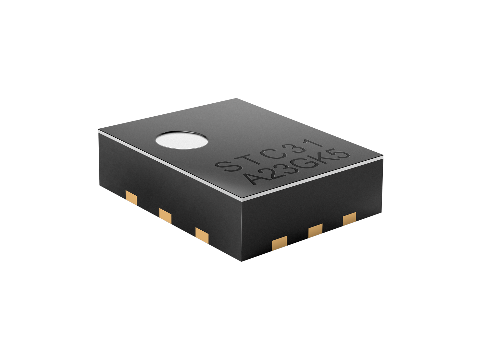

# Python I2C Driver for Sensirion STC3X

This repository contains the Python driver to communicate with a Sensirion sensor of the STC3X family over I2C.

Click [here](https://sensirion.com/products/catalog/SEK-STC31) to learn more about the Sensirion STC3X sensor family.

The measured gas mixture depends on the STC3x product and configured binary gas.
Please refer to the datasheet and API documentation to get a list of supported
binary gases.

## Supported sensor types

| Sensor name   | I²C Addresses  |
| ------------- | -------------- |
|[STC31-C](https://sensirion.com/products/catalog/STC31)| **0x29**|
|[STC31](https://sensirion.com/products/catalog/STC31)| **0x29**|

The following instructions and examples use a *STC31-C*.

## Connect the sensor

You can connect your sensor over a [SEK-SensorBridge](https://developer.sensirion.com/product-support/sek-sensorbridge/).
For special setups you find the sensor pinout in the section below.

Sensor pinout

| *Pin* | *Cable Color* | *Name* | *Description*  | *Comments* |
|-------|---------------|:------:|----------------|------------|
| 1 | red | VDD | Supply Voltage | 2.7V to 5.5V
| 2 | yellow | SCL | I2C: Serial clock input |
| 3 | black | GND | Ground |
| 4 | green | SDA | I2C: Serial data input / output |

## Documentation & Quickstart

See the [documentation page](https://sensirion.github.io/python-i2c-stc3x) for an API description and a
[quickstart](https://sensirion.github.io/python-i2c-stc3x/quickstart.html) example.

## Contributing

In case you want to contribute to this project, please read the [contribution guidelines]((https://sensirion.github.io/python-i2c-stc3x/contributing.html)).

## License

See [LICENSE](LICENSE).